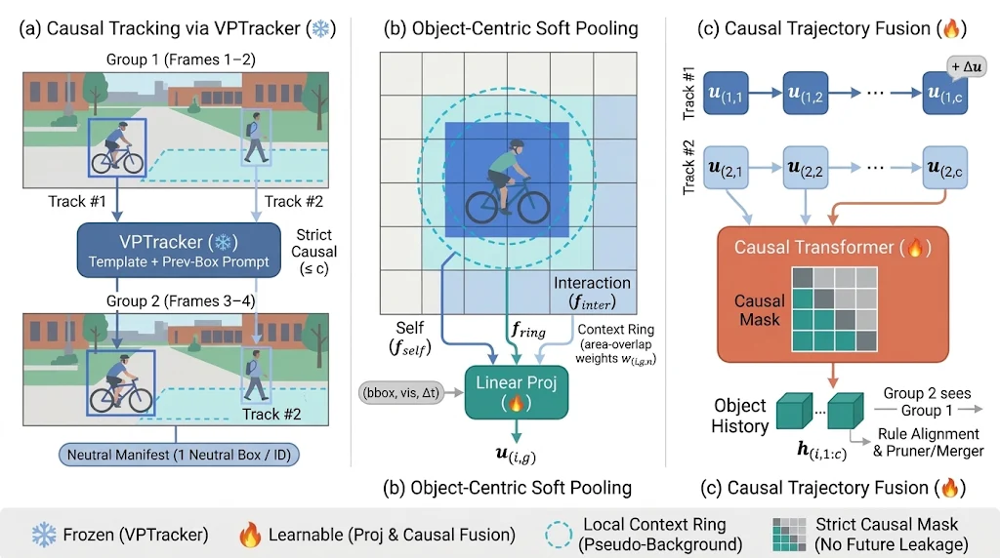
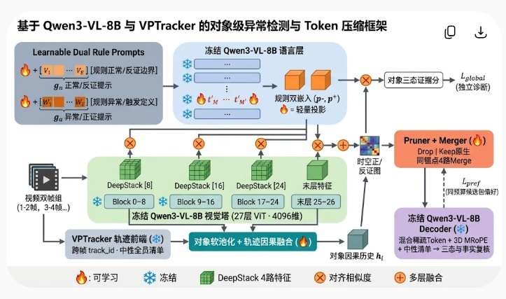
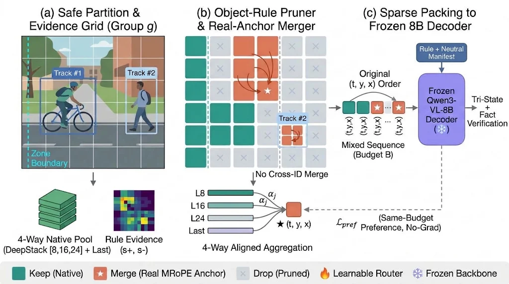

# 对象级视频异常检测与视觉 Token 压缩

2026 年 11 月 23 日 · 组会报告 · VPTracker、QwenCLIP 与 Pruner + Merger

[下载 Word 讲稿（内含三张原图）](reports/2026-11-23/object-vad-meeting.docx)

两段视频的最后一帧里，同一个人都在广场内推车。第一段里，他在界外下车，再把车推进广场。第二段里，他骑车越过边界，到界内才下车。若给定的规则是“区域 A 内禁止骑行，允许推车”，两段视频应得出不同结论。**我们想压缩的是视觉 token，想保住的是足以区分这两段历史的证据。**

## 整条 pipeline 要回答什么

Qwen3-VL 将相邻两个采样帧组成一个时间组。语言层本来就能跨组读取视觉信息，但压缩发生在它之前。一旦过滤器丢掉了骑车越界的瞬间，decoder 即使能看到其余整段视频，也可能只看到一个守规矩的推车人。因此，过滤器需要先沿同一对象回看历史，再决定哪些视觉 token 可以省去。

给定视频、人工规则、待判断时段和观察截止时刻，系统对画面里发现的每个候选对象逐一判断，回答**谁在什么时候触发了哪条规则，哪些可见事实支持这个判断**。涉及区域的规则还需要该机位上的区域标注。下表是同一条假设规则的三个教学示例。

| 截至当前看到了什么 | 对目标人物的判断 | 必须保留的证据 |
| --- | --- | --- |
| 界外已下车，随后全程推车入区 | NO_MATCH · 可判定未触发 | 下车发生在界外，入区时人在车旁 |
| 骑车越界，进入区域后才下车 | MATCH · 已触发 | 同一人骑乘时已在界内，即使结尾在推车 |
| 入区过程被遮挡，只看到界外骑车和界内推车 | UNKNOWN · 证据不足 | 遮挡前后的可见状态，以及无法确定下车位置的缺口 |

**三张图分三步读。** 图 1 把同一人在不同双帧组里的状态接起来。图 2 读取这段历史，根据规则标出支持触发、支持排除的局部证据。图 3 把预算留给这些证据，再让冻结的 Qwen3-VL-8B 看压缩后的视频并作出判断。

这个问题也适用于摔倒与久坐。人在地上的终点画面相似，区分两者需要看到他此前是否有支撑、是否失去平衡，以及如何到达低位。禁骑主要考察动作与区域何时同时成立，摔倒则考察同一对象的状态转变。

## 图 1　VPTracker 怎样接上同一对象的历史

*图 1　左侧确定两组里的目标身份，中间从视觉网格提取对象状态，右侧允许较晚的对象状态读取早先的记录。*

**（a）先确定看的是谁。** 外层检测器发现候选，冻结的 VPTracker 用目标模板和上一帧框续接位置。图中骑车人是 Track #1，旁观者是 Track #2。输出给后端的中性清单为每个候选列一个临时编号、一个可见时刻及当时的框。这个清单给 decoder 一个指人的起点。[VPTracker 的跟踪方法](https://arxiv.org/html/2512.22799v2)

**（b）再取出这个人的可见状态。** 按框与网格的重叠程度加权读取三处特征。主体区域记录人的姿态，近邻环带保留地面和边界，交互对象区域补入自行车等相关物体。三份特征连同框的位置、可见性和时间间隔，投影成对象 i 在双帧组 g 的状态 u(i,g)。遮挡处记录缺失。

**（c）最后接通时间。** 第 1、2 个采样帧组成第一组，第 3、4 个组成第二组。第二组到齐后，我们在跟踪器之后加的可学习时序层，沿 Track #1 读取第一组状态及组间变化。因果掩码保证第一组在当时的输出只使用当时可见的信息。这样得到对象历史 h(i,1:g)。图 2 可以沿这条历史查“何时下车”，也可以按位置回取原生视觉网格。

## 图 2　QwenCLIP 怎样按规则识别异常证据

*图 2　左上两路提示定义取证方向。沿对象历史读出三态诊断，沿视觉网格读出正证和反证的位置，再交给压缩器。*

**把规则变成两个可学习的提示。** QwenCLIP 是本项目拟训练的模块名。它借鉴 Qihang Zhou 等人在 AnomalyCLIP 中用正常、异常提示对齐全局和局部视觉特征的思路。这里把比较单位换成对象轨迹，并给提示加入人工规则。以禁骑为例，正证提示寻找“同一人在区内骑行”，反证提示寻找“入区前已下车，入区后持续推行”。两路文本分别加可学习前缀，通过冻结的 8B 语言层和轻量投影，得到可与视觉特征比较的向量。[AnomalyCLIP 原论文](https://arxiv.org/abs/2310.18961)

**在对象和网格两个尺度上读取。** 全局分支把成对提示与图 1 的对象历史对齐，综合时段内的支持证据、排除证据和可见性，给出对象级三态诊断。局部分支则在主体、交互物和周边网格上，逐位置比较两路提示，融合 DeepStack 第 8、16、24 层与末层的响应，形成两张时空证据图。这里的层号从 0 起算，视觉塔内部宽度为 1152，四路输出各自投影到语言侧的 4096 维。[8B 官方配置](https://huggingface.co/Qwen/Qwen3-VL-8B-Instruct/blob/0c351dd01ed87e9c1b53cbc748cba10e6187ff3b/config.json)

**为什么反证也值得保留。** 一个人扶着车站在界内，只能说明当下的姿态。若早先已有区内骑行的证据，结尾推车仍与违规过程相容。只有把下车的时刻、地点和后续推行接起来，才能排除这段时窗内的禁骑事件。两张响应图标在双帧组的网格上。若要估计某个原始帧对最终结论的贡献，还需替换该帧并重新编码，观察判断怎样变化。

## 图 3　怎样裁剪、合并并送回冻结的 8B

*图 3　绿色保留原生网格，橙色把兼容网格聚合到星标所示的真实位置，灰色删除。右端接收由绿色和橙色共同组成的视觉序列。*

**（a）划出可合并的范围。** 在每个双帧组内，汇合原生网格、轨迹归属、区域边界和图 2 的正反证。两人重叠、人与车的接触处、穿越边界的关键网格优先保护。合并候选限于同组、归属清楚且状态相容的邻近网格，例如同一块平坦路面。

**（b）在共享预算 B 内分配视觉位置。** Keep 原样保留支持或排除事件的细节，Drop 删除对当前判断无用的重复背景。Merge 选择一个真实成员作位置锚点，把其邻居的内容加权汇入。四路特征使用同一组成员及归一化权重，各自聚合。一块路面的多个网格可以压成一个位置，把省下的位置留给人车越界的关键组。各双帧组可以保留不同数量。

**（c）decoder 实际收到什么。** 每个保留位置占一个视觉槽。其末层向量进入语言输入序列，另三路 DeepStack 向量在对应浅层加入同一槽位。混合序列按锚点的原始时空顺序排列，保留原组时间戳和三维位置编码 MRoPE，配上规则、适用区域和中性对象清单。对象历史、热图和上游三态留在过滤器内部。冻结 8B 依据收到的视觉证据输出对象、时段、三态，以及能独立指认的事实，例如“这名人在界内仍骑在车上”。

## 怎样验证三张图确实接通了

**训练信号分别来自哪里。** 对象级监督以人工核验的“对象、规则、时段、观察截止点”为单位，标三态，并记录作此判断所需的可见事实。它监督对象诊断损失 L_global。对路由器，在相同 token 预算下构造两个候选包，例如一包保留越界前的下车动作，另一包只保留结尾推车。依据冻结 8B 对人工核实事实的回答质量产生偏好，训练路由器把较好的包排在前面（L_pref）。冻结 8B 负责评分，可学习的提示、投影、时序层和路由器分别从相应监督更新。

**目前验证到哪一步。** 已有一次 8B 输入接口试验，使用 NWPU、UCF-Crime、XD-Violence 共 6 个独立原视频的短前缀。保留 100% 位置时，重新打包与原生路径在首个输出位置的整词表 logits 逐项一致。压到 50% 时，总视觉位置从 3,200 减至 1,600，实际合并了 14 对，全部位于自动候选框外。全量、仅保留锚点和同锚点合并三种输入，对给定人物均输出“未发生摔倒”的首个数字。指定人物缺少人工真值，这组结果能支持的是输入接口的单步核对。[六段接口试验明细](reports/2026-11-23/interface-pilot.csv)

**组会讨论可围绕三个可检验的问题展开。**

| 想验证的作用 | 怎样把它单独测出来 |
| --- | --- |
| 对象历史能否恢复先后关系 | 保持结尾相似，配对“界外下车”和“界内下车”，或“摔倒”和“原本坐着”，比较完整历史、只看末组和去掉时序融合的结果。 |
| 规则指导压缩能否救回反证 | 使用相同轨迹、预算和 decoder，对比“先保护人物及邻域，最后才读规则”和“先按规则取证再压缩”。同时检查判定与未提示时刻的人、车、区域关系。 |
| Merge 的内容是否有独立价值 | 固定输出位置、数量及顺序，只更换锚点的视觉内容，比较原向量与成员加权向量。再与同预算纯剪枝比较，同时记录含跟踪的端到端耗时。 |
