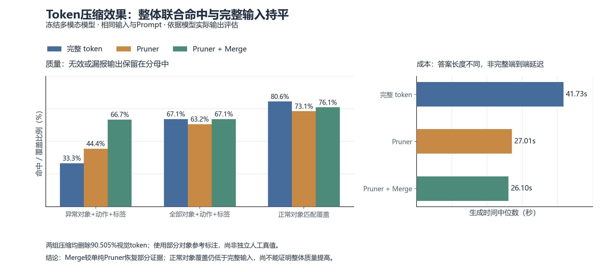
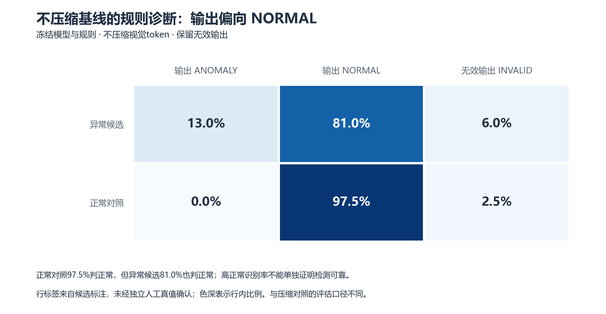

# 对象级视频异常检测：Baseline、压缩方法与实验效果

**汇报周期：2026年10月13日—19日**

## 1. Baseline：冻结Qwen3.5-4B，直接进行对象级异常判断

采用**Qwen3.5-4B多模态模型**，冻结视觉编码器与语言模型。视频按约4 FPS采样，采用等比例720p范围；将全部采样视觉token与“场景描述＋异常／非异常规则＋JSON输出要求”共同输入模型，不使用外部检测器。

目标输出是**谁异常、发生了什么、在哪里、什么时候**，同时区分正常旁观者和异常事件参与者。根据模型实际生成的对象、动作与标签计算指标，而非仅看异常热图或训练loss。

## 2. Token压缩方法：Pruner与Pruner＋Merge

压缩发生在**视觉编码之后、语言模型推理之前**。

- **Pruner（选择并删除）：**结合人物token分数、跨时刻特征变化、局部区域覆盖和特征多样性，为token排序，保留约9.5%的视觉token。不同时间段的配额可变，不固定每帧保留相同数量。
- **Pruner＋Merge（选择并合并）：**保留与Pruner相同的token索引及原始时空位置，再将符合空间／相邻时间约束的特征均值汇入代表token，减少直接删除造成的证据损失。

当前验证版本**尚未接入已训练的token级异常语义分支**；合并分组也不等于可靠的跨帧身份跟踪。

## 3. 实验效果：生成更快，整体检测提升尚未证实

同一组输入与Prompt下，依据模型真实输出进行对照：

| 指标 | 不压缩Baseline | Pruner | Pruner＋Merge |
|---|---:|---:|---:|
| 视觉token删除率 | 0% | 90.505% | 90.505% |
| 异常对象召回率 | 44.44% | 55.56% | 66.67% |
| 异常对象＋动作＋标签命中率 | 33.33% | 44.44% | 66.67% |
| 对象＋动作＋标签联合命中率 | 67.11% | 63.16% | 67.11% |
| 正常对象匹配覆盖率 | 80.60% | 73.13% | 76.12% |
| 生成时间中位数 | 41.73秒 | 27.01秒 | 26.10秒 |

联合命中要求对象身份、核心动作与正常／异常标签同时正确；正常对象匹配覆盖不等于正常分类准确率。

**结果解读：**Pruner＋Merge的异常对象召回率高于Baseline，整体联合命中率持平；生成时间中位数从41.73秒降至26.10秒，约减少37.45%。但正常对象匹配覆盖率下降，说明仍会丢失正常旁观者证据，不能据此认定压缩后整体检测更好。

此外，独立的不压缩规则诊断中，异常候选片段输出ANOMALY的比例为**13.00%**，正常对照片段输出NORMAL的比例为**97.50%**，显示模型存在明显的判正常倾向。该诊断与上述压缩对照口径不同，不能作为压缩前后的性能变化。

**评估限制与下一步：**当前指标依据部分对象参考或候选标注计算，尚非独立人工真值下的正式AP/AUC；生成时间也不等于完整端到端延迟。下一步先通过“提取对象与动作事实→依据场景规则判断”强化不压缩基线，再检验压缩能否同时保住异常对象、正常旁观者和交互角色。

---

[查看指标数据与评估口径](data/group_meeting_20261019/metrics.json)
