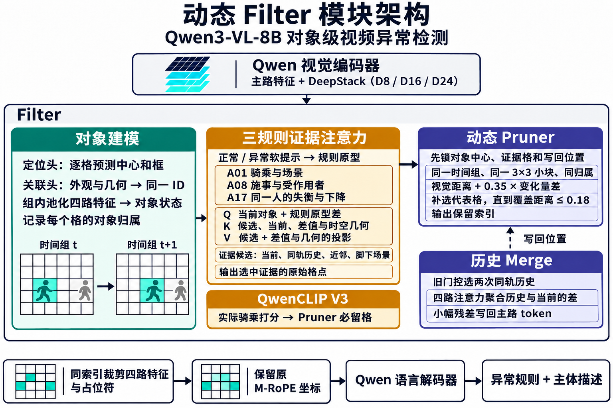
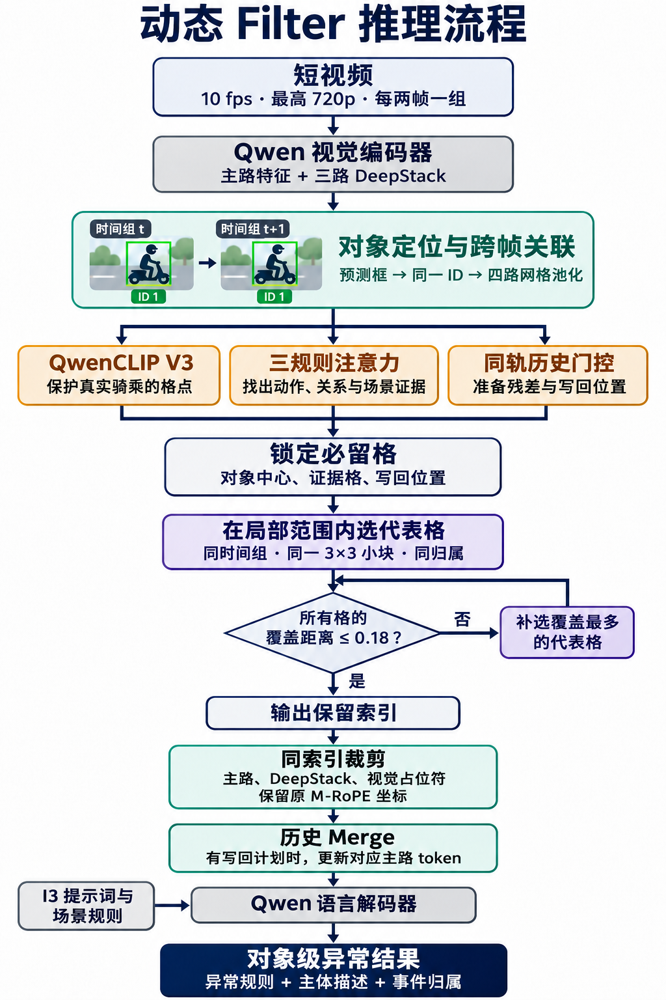
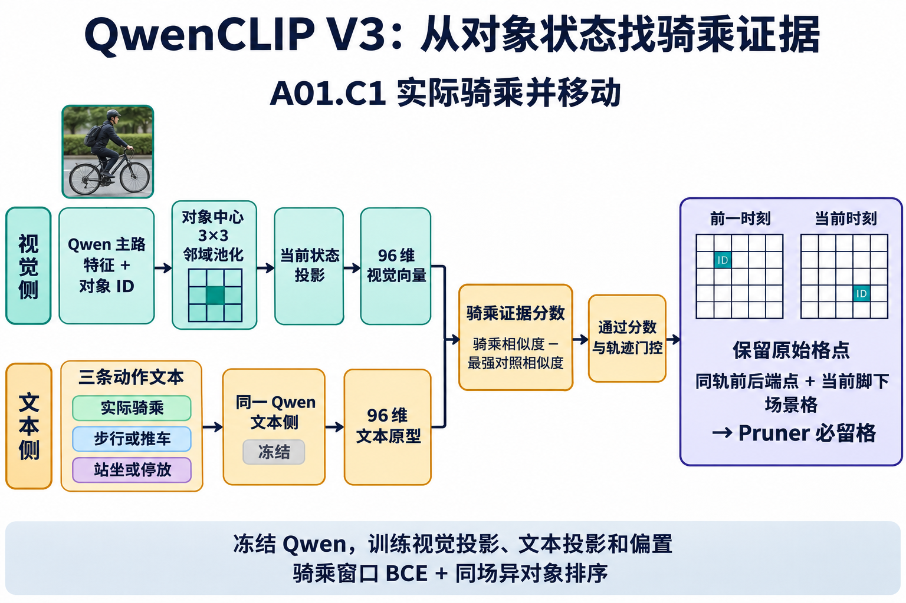
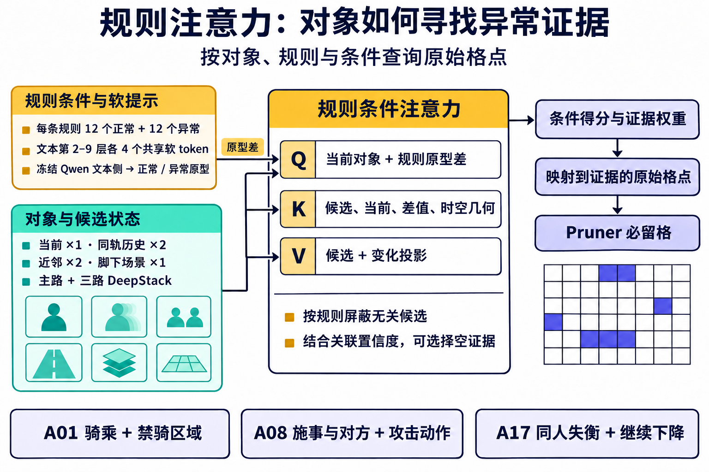
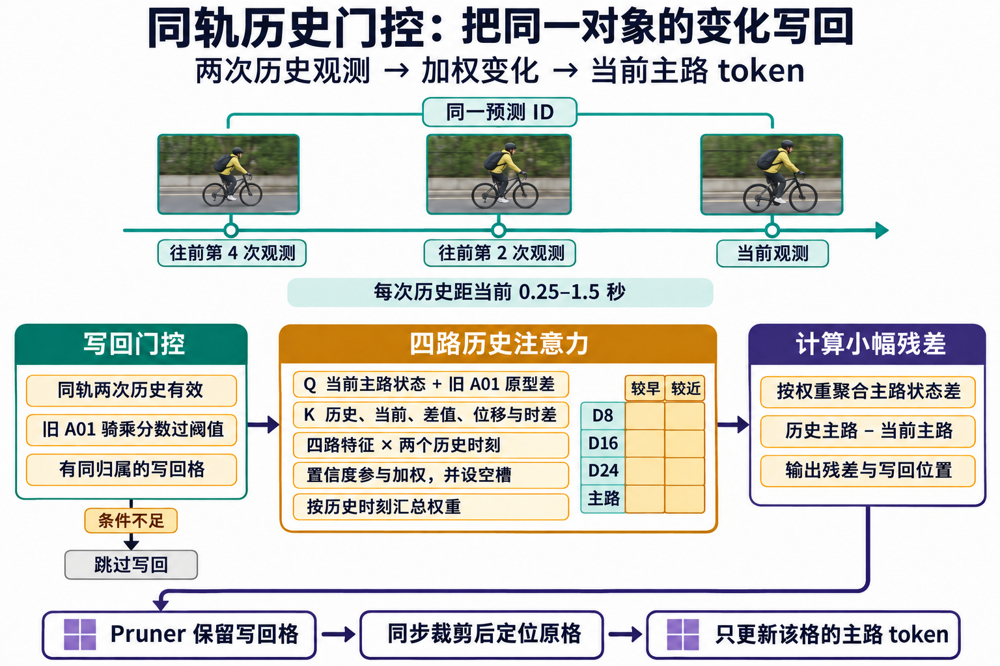
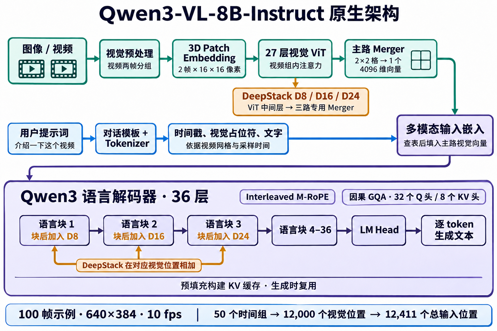
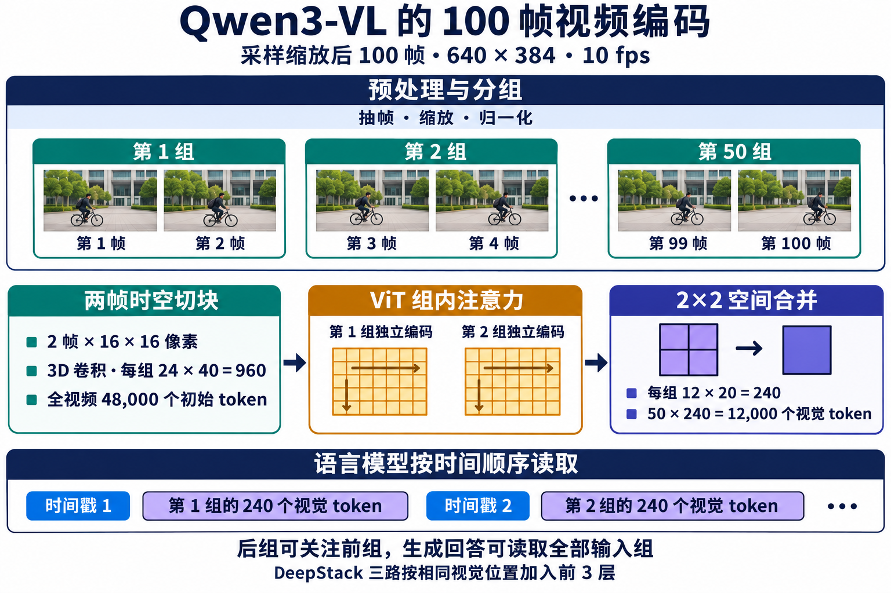

# 对象级视频异常检测与动态 Token Filter

下表汇总 Qwen3-VL-8B-Instruct 在原 96 段视频上的结果。异常种类和异常主体绑定的命中率分别以已标注的片段–规则和主体–规则正例为分母。

| 类别 异常命中率 / 异常+对象命中率（%） | Qwen3-VL-8B-Instruct（NF4） + 无压缩 | Qwen3-VL-8B-Instruct（NF4） + 动态 Filter（0.18） | Qwen3-VL-8B-Instruct（BF16） + 无压缩 | Qwen3-VL-8B-Instruct（BF16） + 动态 Filter（0.18） |
| --- | ---: | ---: | ---: | ---: |
| A01 禁骑区骑行 | 异常 64/64（100%） 异常+对象 27/84（32.14%） | 异常 64/64（100%） 异常+对象 36/84（42.86%） | 异常 62/64（96.88%） 异常+对象 46/84（54.76%） | 异常 64/64（100%） 异常+对象 45/84（53.57%） |
| A08 对人攻击 | 异常 22/24（91.67%） 异常+对象 23/31（74.19%） | 异常 21/24（87.5%） 异常+对象 21/31（67.74%） | 异常 21/24（87.5%） 异常+对象 21/31（67.74%） | 异常 21/24（87.5%） 异常+对象 21/31（67.74%） |
| A09 朝人挥砸或攻击尝试 | 异常 2/2（100%） 异常+对象 2/2（100%） | 异常 2/2（100%） 异常+对象 2/2（100%） | 异常 2/2（100%） 异常+对象 2/2（100%） | 异常 2/2（100%） 异常+对象 2/2（100%） |
| A10 强行取物 | 异常 0/1（0%） 异常+对象 0/1（0%） | 异常 0/1（0%） 异常+对象 0/1（0%） | 异常 0/1（0%） 异常+对象 0/1（0%） | 异常 0/1（0%） 异常+对象 0/1（0%） |
| A11 强力翻砸或抛散物品 | 异常 1/2（50%） 异常+对象 1/2（50%） | 异常 1/2（50%） 异常+对象 1/2（50%） | 异常 1/2（50%） 异常+对象 1/2（50%） | 异常 1/2（50%） 异常+对象 1/2（50%） |
| A17 失衡或跌倒 | 异常 5/9（55.56%） 异常+对象 2/10（20%） | 异常 3/9（33.33%） 异常+对象 2/10（20%） | 异常 4/9（44.44%） 异常+对象 2/10（20%） | 异常 3/9（33.33%） 异常+对象 1/10（10%） |
| A34 实际碰撞或冲击 | 异常 1/3（33.33%） 异常+对象 0/5（0%） | 异常 0/3（0%） 异常+对象 0/5（0%） | 异常 0/3（0%） 异常+对象 0/5（0%） | 异常 0/3（0%） 异常+对象 0/5（0%） |
| A35 人与动物定向冲突 | 异常 2/2（100%） 异常+对象 2/2（100%） | 异常 2/2（100%） 异常+对象 1/2（50%） | 异常 2/2（100%） 异常+对象 2/2（100%） | 异常 2/2（100%） 异常+对象 2/2（100%） |
| **全部规则（按正例汇总）** | 异常 97/107（90.65%） 异常+对象 57/137（41.61%） | 异常 93/107（86.92%） 异常+对象 63/137（45.99%） | 异常 92/107（85.98%） 异常+对象 74/137（54.01%） | 异常 93/107（86.92%） 异常+对象 72/137（52.55%） |
| **视觉 token 数（96 段合计）** | 2,032,360 | 700,201 | 2,032,360 | 700,099 |
| **减少的视觉 token（压缩比例）** | 0（0%） | **1,332,159（65.55%）** | 0（0%） | **1,332,261（65.55%）** |

## Filter 架构与推理流程

两张图对应上表 96 段实验中的动态 Filter，覆盖距离阈值为 0.18。

### 模块架构

### 完整推理流程

### 三个模块详解

#### 1. QwenCLIP V3 · 这个人在骑，还是在推？

把当前对象中心附近的视觉特征和三条动作文本投到同一个 96 维空间。用「实际骑乘」的相似度减去最相似的对照动作分数，对照包括步行或推车、站坐或停放。分数和轨迹门控通过后，保护同轨窗口的前后端点和当前脚下的格点。是否违规还要结合场景规则。

#### 2. 规则注意力 · 判断这条规则要看哪里？

以跌倒为例，要找同一个人从稳定到失衡、再继续下降的证据。**Q** 由当前对象和正常／异常原型差组成，**K** 编码候选、当前状态、两者差值和时空几何，**V** 是带变化信息的候选特征。注意力从当前、同轨历史、近邻和脚下场景里选证据，再把它们映回原始格点交给 Pruner。

#### 3. 同轨历史门控 · 同一个人过去的变化怎么带回来？

从同一预测 ID 取往前第 4 次和第 2 次观测。旧 A01 门控通过后，四路特征为这两次历史分配权重，聚合「历史主路状态 − 当前主路状态」得到小幅残差。Pruner 先保住写回格，裁剪后再更新该格的主路 token。**这版历史写回由旧 A01 门控触发，A17 的历史证据由规则注意力保留原始格点。**

## 当前瓶颈与难点

**目前最大的瓶颈是把异常稳定地绑到具体对象。** 在 GitHub 的 96 段 BF16 动态 Filter 结果里，异常种类命中 **93/107（86.92%）**，异常和主体都判对的有 **72/137（52.55%）**。A01 禁骑区骑行的 **64 段视频全部识别到**，但只绑对 **45/84** 个骑行主体。按漏绑数量，A01 是这批数据里影响最大的一类。按识别难度，A17 跌倒最突出，无压缩也只绑对 **2/10**，加动态 Filter 后是 **1/10**。[96 段实验表](#对象级视频异常检测与动态-token-filter)

### 难在三个环节

1. **单个时间组能找到人，跨时间组容易断开。** 在来源留出集里，有参考框的 21 个异常主体中，18 个至少在一个时间组被较准确地框到（IoU ≥ 0.5），但正确连到同一主体的相邻组只有 **104/319**。一旦遮挡、交错或姿态变化导致 ID 断开，后面的规则注意力就可能读不到这个人的历史。
2. **跌倒需要看见同一人的转折过程。** 「站稳 → 失衡 → 落到低位」才能把跌倒和主动蹲下、片首已经卧地分开。复核的 6 段跌倒中，只有 **2 段**完整保留了三个标注点，**0 段**把三个点对齐到同一条预测阶段轨迹。现版 A17 主要靠规则注意力保留原始历史格，Merge 仍沿用 A01 骑乘门控。另一次固定掩码的失败复现还发现，人体框内的历史池化格实际落到了桌边或地面。[跌倒案例对照](assets/vad-filter-2026-11-17/04-a17-case-comparison.png) · [Merge 写回可视化](assets/vad-filter-2026-11-17/05-a17-writebacks.png)
3. **保住证据之后，Qwen 仍要把规则、角色和描述对应起来。** 推搡场景里，施力者是 A08 主体，被推的人如果随后失衡倒地，则可能是 A17 主体。已有错例把这两个人的规则对调。现在 Filter 的预测 ID 用于内部选点和关联，最终仍由 Qwen 根据视觉 token 生成可唯一指人的描述，这一步也会漏绑或错绑。

**速度上，压缩收益主要落在语言模型的输入阶段。** 动态版减少了 **65.55%** 的输入视觉 token，视觉塔仍先编码全部 10 fps 采样帧，之后还要逐 token 生成结构化输出。原 BF16 计时里，动态版从首 token 到生成结束的中位数约 **21.3 秒**，两组端到端中位数为无压缩 **30.59 秒**、动态版 **32.18 秒**，且运行条件和输出长度有差异。[动态 token 预算](assets/vad-filter-2026-11-17/03-dynamic-token-budgets.png)

对论文来说，最难验证的是**压缩后保住的证据，是否确实来自同一个主体、覆盖关键变化，并被模型用来做对绑定**。原 23 段来源留出集里没有 A17 正例。外部 22 段复测中，重训 Filter 绑对 **12/22**，旧 Filter 是 **11/22**，无压缩是 **15/22**。跨来源的绑定收益目前还不稳定。[外部留出复测](assets/vad-filter-2026-11-17/06-external-22-retrain.png)

## Qwen3-VL 的视觉编码与跨组关系

以采样后 100 帧、640×384、10 fps 为例，每两帧形成一组。视觉塔在每组的 960 个初始 token 之间计算注意力。每组经 2×2 空间合并后有 240 个视觉位置，50 组合计 12,000 个。使用官方对话模板，先放视频再输入「介绍一下这个视频」，这一算例共有 12,411 个输入位置。

第 1、2 帧和第 3、4 帧各自编码。进入语言解码器后，第 2 组的查询可读取第 1 组的键和值，位于视频之后的提示词和回答可读取全部视频组。D8、D16、D24 分别在前 3 个语言块之后加到对应的视觉位置。Filter 位于空间合并和语言解码之间，用同一份索引裁剪主路、三路 DeepStack 和视觉占位符。

[Qwen3-VL 技术报告](https://arxiv.org/html/2511.21631#S2) · [模型源码](https://github.com/huggingface/transformers/blob/v4.57.1/src/transformers/models/qwen3_vl/modeling_qwen3_vl.py)
